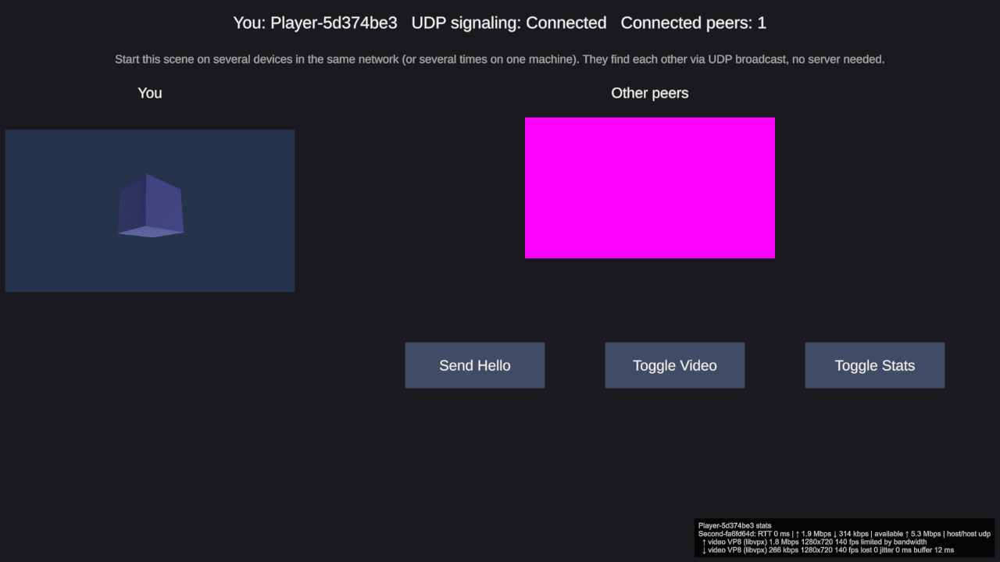

# Custom Signaling Transport (UDP, no server)

Shows how to connect SimpleWebRTC to **your own signaling backend**. The sample contains a complete, working transport, `UdpBroadcastSignaling`. It finds other instances of the app in the **local network via UDP broadcast**, so several apps or devices in the same Wi-Fi connect to each other without any server.



## Contents
| File | Purpose |
|------|---------|
| `WebRTC-CustomSignaling-UdpBroadcast.unity` | Sample scene: video, chat and statistics over UDP broadcast signaling |
| `UdpBroadcastSignaling.cs` | The custom transport, about 180 lines with comments |
| `LanSampleChat.cs` | Small UI script: status line, chat log and the *Send Hello* button |
| `ExampleCustomSignaling.cs` | Minimal commented template to start your own transport |

## Requirements
- SimpleWebRTC 2.x with [WebRTC (FDGS)](https://github.com/FireDragonGameStudio/com.unity.webrtc.fdgs) 3.2.0+
- All instances in the **same local network**: UDP broadcasts don't cross routers
- Not available on WebGL, because browsers have no UDP sockets
- **Android / Meta Quest:** Android drops broadcast packets unless the app holds a Wi-Fi multicast lock. The transport acquires it automatically, but your app needs this permission. Enable *Custom Main Manifest* in Player Settings > Publishing Settings and add the line to `Assets/Plugins/Android/AndroidManifest.xml`:
  ```xml
  <uses-permission android:name="android.permission.CHANGE_WIFI_MULTICAST_STATE"/>
  ```

## How to run
1. Build the scene (File > Build Profiles) and start the player, then press Play in the Editor as well. You can also start the build several times, or run it on several devices in the same network.
2. Every instance connects on start. Within a few seconds the status line shows `Connected peers: 1` (or more), and the other instances' cubes appear under **Other peers**. Each instance has a random cube color, so you can tell them apart.
3. **Send Hello** sends a chat message to everyone. **Toggle Video** stops and starts your stream. **Toggle Stats** shows the statistics overlay in the bottom right corner.

On Windows, allow the app through the firewall for private networks when asked. The transport uses UDP port **47777**, which you can change on the component.

## What's in the scene
`LAN-Client` has the usual SimpleWebRTC components. Only the signaling transport is custom:

| Component | Setting |
|-----------|---------|
| `UdpBroadcastSignaling` | port 47777, also sends to localhost (so instances on one PC find each other) |
| `WebRTCPeerManager` | peer id `Player` + random suffix, *Connect On Start*, uses `UdpBroadcastSignaling` as **Signaling** |
| `DataChannel` | chat channel |
| `CameraVideoSource` + `VideoSender` | streams `StreamingCamera`, which films `StreamedCube`; preview in the *You* panel |
| `VideoReceiver` + `RawImageVideoSink` | one RawImage per remote peer in the *Other peers* grid |
| `WebRTCStatsMonitor` | overlay bottom right, toggled by the button |
| `LanSampleChat` | status line and chat log |

## How a signaling transport works
A transport only has to move strings between all clients. Rooms, peer ids, offers, answers and ICE candidates are handled by `WebRTCPeerManager`. Derive from `SignalingTransport` and implement three methods:

```csharp
public class MySignaling : SignalingTransport {
    public override void Connect() {
        SetState(SignalingState.Connecting);
        // connect to your backend, then:
        SetState(SignalingState.Connected);
    }

    public override void Disconnect() {
        // close the connection, then:
        SetState(SignalingState.Disconnected);
    }

    public override void Send(string message) {
        // deliver the message to all other connected clients
    }

    // call this for every message that arrives from another client
    private void OnBackendMessage(string message) => ReceiveMessage(message);
}
```

`SetState` and `ReceiveMessage` can be called from any thread; SimpleWebRTC passes them to the main thread. Assign your component as **Signaling** on the `WebRTCPeerManager`, and that's it.

`UdpBroadcastSignaling` implements exactly this:
- **Connect:** opens a UDP socket on the port with address reuse, so several apps on one machine can share it, and starts a receive thread.
- **Send:** sends the message as a broadcast datagram (and to localhost). It adds a header with an instance id and a sequence number.
- **Receive:** drops its own messages and duplicates (a datagram can arrive via broadcast and via localhost), and passes everything else to `ReceiveMessage`.

`ExampleCustomSignaling.cs` is the same skeleton with comments, ready to fill in with your backend, e.g. REST polling, Firebase, a game server you already have, Mirror or Netcode for GameObjects messages.

## Limitations of the UDP example
- Local network only.
- Signaling messages are not encrypted. The WebRTC media itself is always encrypted.
- Lost datagrams are not resent. That's rare in a LAN, and disconnecting and connecting again fixes a stuck peer.

For connections over the internet, use `WebSocketSignaling` with a server (see the *Example Scenes* sample) or your own backend.
