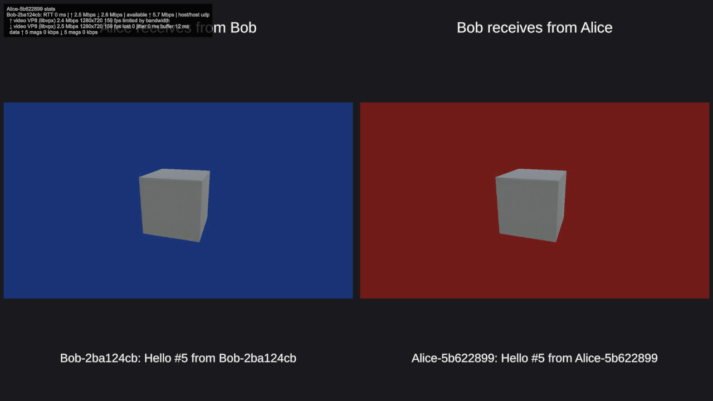
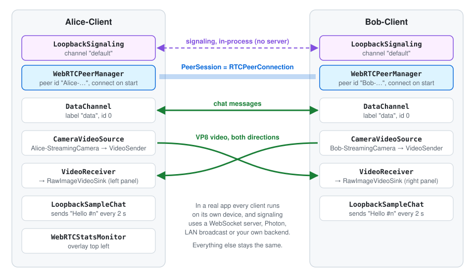

# Loopback Sample (no server)

Two WebRTC peers, **Alice** and **Bob**, in one scene, sending each other camera video and chat messages. They use `LoopbackSignaling`, which passes the signaling messages between components in the same app, so **no signaling server and no second device are needed**. Press Play and it works.

This is the easiest way to see WebRTC working, and a good starting point for understanding SimpleWebRTC. The main README's section [How WebRTC works](../../README.md#how-webrtc-works) uses this sample as its walkthrough.

## Requirements
- SimpleWebRTC 2.x with [WebRTC (FDGS)](https://github.com/FireDragonGameStudio/com.unity.webrtc.fdgs) 3.2.0+
- Nothing else: no WebSocket package, no server, no network

## How to run
1. Open `WebRTC-Loopback-NoServer`.
2. Press Play.

Within a second:
- the left panel shows what **Alice receives from Bob**: Bob's camera, looking at his cube in front of a blue background,
- the right panel shows what **Bob receives from Alice**: her red camera view,
- every 2 seconds each side sends `Hello #n from <peer id>`, shown below the panels,
- the overlay in the top left corner shows Alice's connection statistics: round trip time, bitrate, VP8 resolution and FPS, and the network path `host/host udp`.

## What's in the scene

| Object | Components | Purpose |
|--------|------------|---------|
| `Alice-Client`, `Bob-Client` | `LoopbackSignaling` (channel `default`) | in-process signaling instead of a server |
| | `WebRTCPeerManager` (*Connect On Start*, no ICE servers) | creates the connection to the other peer |
| | `DataChannel` (label `data`, id 0) | chat channel |
| | `CameraVideoSource` + `VideoSender` (*Stream On Enable*) | streams `Alice-StreamingCamera` / `Bob-StreamingCamera` |
| | `VideoReceiver` + `RawImageVideoSink` | shows the other peer's video in the panel's RawImage |
| | `LoopbackSampleChat` | sends a chat message every 2 s and shows the last received one |
| `Alice-Client` only | `WebRTCStatsMonitor` (*Show Overlay*) | the statistics overlay |
| `Alice-Cube`, `Bob-Cube` | `ContinuousRotation` | something moving for the cameras to film |
| `Canvas` | two panels with titles, video RawImages and chat texts | |

The two clients don't reference each other. They only find each other because both `LoopbackSignaling` components use the same channel name, exactly like two apps that connect to the same signaling server.

## What happens when you press Play
1. Both `WebRTCPeerManager`s connect their `LoopbackSignaling`. The second one sends `join`, and the other one replies with `welcome`. Each side creates a `PeerSession`.
2. `DataChannel` and `VideoSender` add their channel and video track to the new session.
3. Bob (the "impolite" peer, because his peer id sorts higher) sends the SDP **offer**, and Alice replies with the **answer**. Both exchange ICE **candidates**. On one machine the local *host* candidates are enough, which is why no STUN server is configured.
4. The connection reaches `Connected`. Each `VideoReceiver` receives the other camera, and the chat messages start to flow.

Enable **Show Logs** on a `WebRTCPeerManager` (on by default) to follow these steps in the Console: `created session`, `sending offer`, `sending answer`, `connection state Connected`.

## Things to try
- Select `Alice-Client` in Play mode and press **Stop Streaming** on the `VideoSender`. Bob's panel goes empty. **Start Streaming** brings it back, without reconnecting.
- Set **Max Bitrate Kbps** on a `VideoSender` to e.g. 300 before pressing Play, and watch the bitrate and quality change in the overlay.
- Change **Preferred Video Codec** on both peer managers to `VP9` and check the codec in the overlay. H264 depends on hardware encoder support on your platform.
- Add a third client: duplicate `Bob-Client`, give it its own camera and RawImage, and it joins the same loopback channel.
- Look at `LoopbackSampleChat.cs`, about 40 lines, to see how a script sends and receives data channel messages.

## From here to a real app
Replace `LoopbackSignaling` with a transport that reaches other machines, and run each client on its own device:
- `WebSocketSignaling` with a server, see the *Example Scenes* sample,
- `UdpBroadcastSignaling` in the local network, see the *Custom Signaling Transport* sample,
- `PhotonFusionSignaling`, see the *Photon Fusion 2* sample.

Everything else stays exactly the same.
