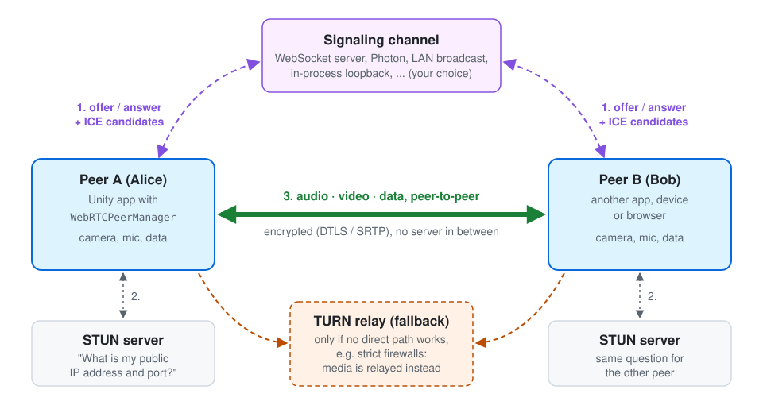
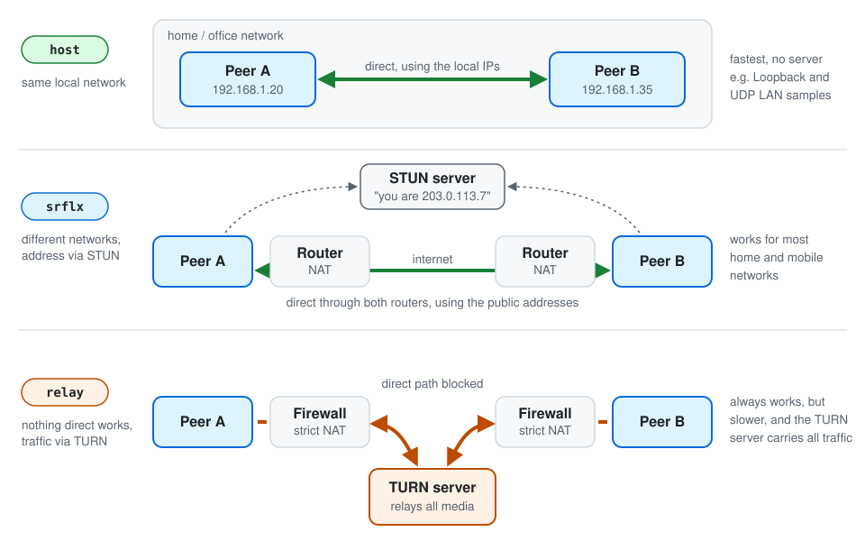
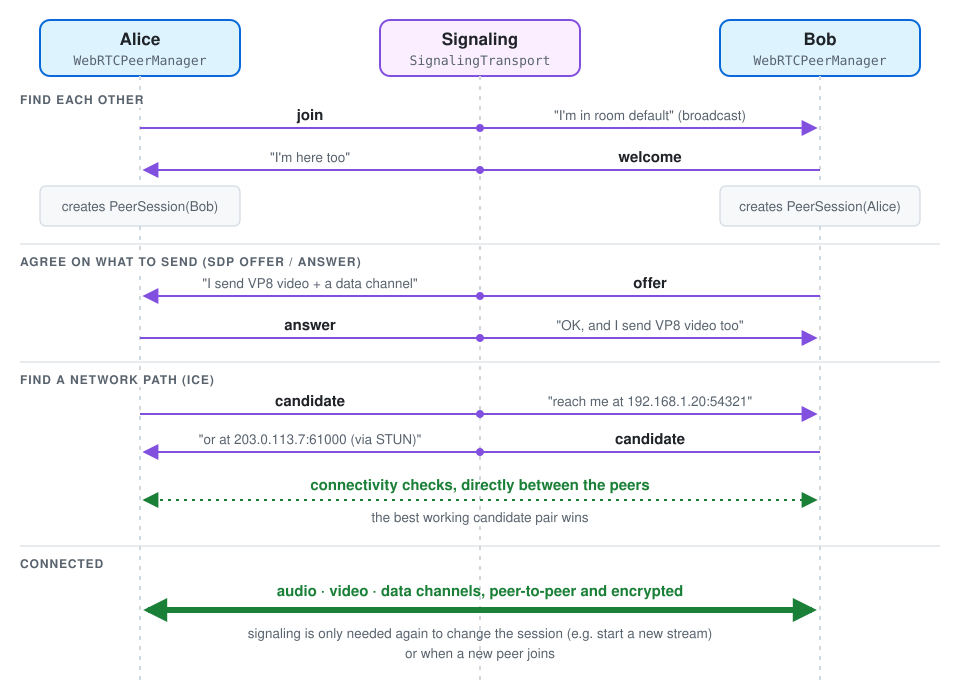

# SimpleWebRTC
SimpleWebRTC is a component-based Unity wrapper for peer-to-peer audio, video, 360° video and data communication over WebRTC. It builds on [WebRTC (FDGS)](https://github.com/FireDragonGameStudio/com.unity.webrtc.fdgs), the community-maintained fork of Unity's WebRTC package.

Version 2.0 splits the former all-in-one `WebRTCConnection` into small components. Add only what you need, swap the signaling backend, or write your own video sources, sinks and transports without touching the WebRTC core.

New to WebRTC? [How WebRTC works](#how-webrtc-works) explains the basics, using the Loopback sample as a walkthrough.

## Features
- Full-mesh peer-to-peer connections with automatic ("perfect") negotiation. Peers can join late and start or stop streams at any time.
- Pluggable signaling: WebSocket ([NativeWebSocket](https://github.com/endel/NativeWebSocket) or the Meta Voice SDK version), Photon Fusion 2, in-process loopback, or your own transport.
- Rooms, so several apps can share one signaling server.
- Data channels (text and binary, reliable or unreliable, several channels per connection).
- Video from cameras, textures, webcams or as 360° video (mono or stereo over-under).
- Received video shown in RawImages, on renderers or in RenderTextures.
- Audio from AudioSources or the microphone, played back per peer.
- STUN and TURN servers, preferred video codec, bitrate and framerate limits.
- Connection statistics per peer (round trip time, bitrates, FPS, resolution, codecs, packet loss, jitter, direct or TURN-relayed path), with an optional on-screen overlay.
- Unity Visual Scripting nodes and events.
- A compatible browser client, [SimpleWebRTC-Web](https://github.com/FireDragonGameStudio/SimpleWebRTC-Web), so web browsers can join the same rooms as your Unity apps.
- Migration tool for SimpleWebRTC 1.x scenes.

## Requirements
- Unity 6000.0 or newer
- [WebRTC (FDGS)](https://github.com/FireDragonGameStudio/com.unity.webrtc.fdgs) `com.fdgs.webrtc` 3.2.0 or newer
- For WebSocket signaling, one of:
  - [NativeWebSocket](https://github.com/endel/NativeWebSocket) 2.x (`https://github.com/endel/NativeWebSocket.git#upm-2`)
  - the Meta Voice SDK (`com.meta.xr.sdk.voice`), which already contains a NativeWebSocket version
- Optional: Photon Fusion 2, Unity Visual Scripting

UPM packages cannot depend on git packages, so install WebRTC (FDGS) and NativeWebSocket yourself. Without WebRTC (FDGS), SimpleWebRTC is not compiled and offers to install it. Tools > SimpleWebRTC > Check Dependencies shows what is available.

## Installation
### Unity Package Manager
1. Open the Package Manager, click on the + sign and select "Add package from git URL".
2. Add `https://github.com/FireDragonGameStudio/com.unity.webrtc.fdgs.git#v3.2.0`
3. Add `https://github.com/endel/NativeWebSocket.git#upm-2` (skip this if the Meta Voice SDK is installed)
4. Add `https://github.com/FireDragonGameStudio/SimpleWebRTC.git?path=/Packages/com.fdgs.simplewebrtc`

### Unity Asset Store
Install [SimpleWebRTC](https://assetstore.unity.com/packages/tools/network/simplewebrtc-309727) from the Asset Store and add the dependencies above.

### Signaling server
SimpleWebRTC only needs a WebSocket server that relays every message to all other connected clients. A ready-to-use Node.js server is in `Server~` (also in `Runtime/SignalServerCode.txt`):
```sh
cd Server~
npm install
npm start   # ws://localhost:3000, set PORT to change it
```
Host it anywhere that supports WebSockets, then use `wss://your-host` as the server URL.

## How WebRTC works
WebRTC lets two apps send audio, video and data **directly to each other** (peer-to-peer) instead of routing everything through a game server. That means low latency and no server bandwidth for the media. To get there, the two peers have to solve three problems:

1. **Find each other** and agree on what they want to send (signaling with an offer and an answer).
2. **Find a network path** between them, even though both are usually behind routers (ICE, with help from STUN and TURN servers).
3. **Send the media and data**, encrypted, over that path.



### 1. Signaling: introducing the peers
Before two peers can talk directly, they need to exchange a few small text messages through some channel they can both already reach. WebRTC deliberately does not say what that channel is. A WebSocket server, a multiplayer backend, a LAN broadcast or anything else that delivers text works.

In SimpleWebRTC this channel is a `SignalingTransport`: `WebSocketSignaling`, `PhotonFusionSignaling`, `LoopbackSignaling`, the UDP broadcast sample, or your own. The signaling channel is only used to set up and change connections. Audio, video and data never go through it.

### 2. Offer and answer: agreeing on what to send
Each peer describes its side of the session in an **SDP** text: which audio and video tracks it sends, which codecs it supports (e.g. VP8, H264, Opus), which data channels it opens, and the keys for encryption. One peer sends its description as an **offer**, and the other replies with an **answer**. After that, both know what to expect.

Whenever something changes, for example a peer starts its camera, the peers exchange a new offer and answer. SimpleWebRTC does this automatically in every `PeerSession` using "perfect negotiation". If both peers send an offer at the same moment, the "polite" peer gives way and the collision resolves itself.

### 3. ICE: finding a network path
Most devices sit behind a router (NAT) and only know their local address, like `192.168.1.20`. To find a path anyway, each peer collects **ICE candidates**: addresses where it might be reachable. It sends them to the other peer through signaling. Both peers then test the candidate pairs directly against each other, and the best pair that works is used.



- **host**: the local address. This works when both peers are in the same network.
- **srflx** (server reflexive): the public address of the router, which the peer learns by asking a **STUN** server. This works for most home and mobile networks.
- **relay**: an address on a **TURN** server that forwards all traffic. It's needed when firewalls or strict NATs block every direct path, for example in some corporate or mobile networks.

In SimpleWebRTC you set these servers in the **Ice Servers** list of the `WebRTCPeerManager`. It uses a public Google STUN server by default. For apps that must work everywhere, add your own TURN server with a username and credential (e.g. [coturn](https://github.com/coturn/coturn) or a hosted TURN service). The `WebRTCStatsMonitor` shows which candidate types a connection uses, for example `host/host udp` or `relay/srflx udp (TURN)`.

### 4. Media and data
Once a path is found, the peers send:
- **Media tracks**: camera or texture video and audio, compressed by a codec such as VP8 or Opus. `VideoSender` and `AudioSender` send them; `VideoReceiver` and `AudioReceiver` play them back.
- **Data channels**: any text or binary messages. They can be reliable and ordered like TCP, or unreliable like UDP for fast, frequently updated data such as positions. In SimpleWebRTC that is the `DataChannel` component.

Everything is encrypted (DTLS and SRTP), and WebRTC does not allow unencrypted connections.

SimpleWebRTC connects every peer to every other peer (a **full mesh**). Each peer sends its own stream to every other peer, so upload bandwidth and encoding work grow with the number of peers. This works well for small groups, typically up to about 4 to 6 peers with video. Larger groups need a media server (SFU), which is not part of SimpleWebRTC.

### Walkthrough: the Loopback sample
The *Loopback* sample runs two clients, Alice and Bob, in one scene. The whole connection setup happens on one machine without any server, so it's a good place to watch the steps above. Import it from the Package Manager, press Play, and enable **Show Logs** on a `WebRTCPeerManager` to follow along in the Console.


1. **Connect:** both `WebRTCPeerManager`s have *Connect On Start* enabled. Their `LoopbackSignaling` components join the in-process channel `default`, which takes the place of a signaling server.
2. **Find each other:** the client that connects second broadcasts `join`. The other one creates a `PeerSession` for it and replies with `welcome`, and the first one creates its `PeerSession` as well. You'll see `created session [Alice-… -> Bob-…]` in the Console.
3. **Add features to the session:** each component hooks into the new session. `DataChannel` opens the channel `data` (id 0), and `VideoSender` adds a video transceiver with the camera track, because *Stream On Enable* is set.
4. **Offer and answer:** Bob has the higher peer id, so he is the "impolite" peer and sends the first `offer`. Alice sends the `answer`, and both exchange `candidate` messages. Both clients run on the same machine, so the local *host* candidates are enough. That's why the sample has no STUN server configured.
5. **Connected:** the Console shows `connection state Connected`. Each `VideoReceiver` gets the other client's video track, and its `RawImageVideoSink` shows it in the panel. `LoopbackSampleChat` sends a message over the data channel every 2 seconds, and the stats overlay shows the VP8 streams with `RTT 0 ms` over `host/host udp`.



To turn this into a real app, put each client on its own device and replace `LoopbackSignaling` with a transport that reaches other machines. The *Example Scenes* use `WebSocketSignaling` with the server from `Server~`, and the *Custom Signaling Transport* sample uses UDP broadcast in the local network. Everything else stays the same.

### Further reading
- [webrtc.org](https://webrtc.org/): the WebRTC project, getting-started guides and samples
- [Get started with WebRTC](https://web.dev/articles/webrtc-basics) on web.dev: a broader introduction to signaling, ICE, STUN/TURN and security
- [WebRTC API on MDN](https://developer.mozilla.org/en-US/docs/Web/API/WebRTC_API): reference and protocol details

## Architecture
```
WebRTCPeerManager ── one PeerSession (RTCPeerConnection) per remote peer
 ├─ SignalingTransport   WebSocketSignaling | MetaWebSocketSignaling | PhotonFusionSignaling | LoopbackSignaling | your own
 ├─ DataChannel          any number, each with its own channel id
 ├─ VideoSender ── VideoSource      CameraVideoSource | TextureVideoSource | WebCamVideoSource | CubemapVideoSource | your own
 ├─ VideoReceiver ── VideoSink      RawImageVideoSink | RendererVideoSink | RenderTextureVideoSink | your own
 ├─ AudioSender                     AudioSource or microphone
 ├─ AudioReceiver                   one AudioSource per peer
 └─ WebRTCStatsMonitor              connection statistics per peer
```
All feature components find the `WebRTCPeerManager` on their GameObject or a parent. Put them on one GameObject, or on children for a cleaner hierarchy.

### Quick start
1. Create a GameObject and add `WebRTCPeerManager` and `WebSocketSignaling`. Assign the signaling component to the manager and set the server URL.
2. Add a `DataChannel`.
3. To send video, add a `CameraVideoSource` (assign a camera) and a `VideoSender` (assign the source).
4. To receive video, add a `RawImageVideoSink` (assign a RawImage or a parent for spawned images) and a `VideoReceiver` (add the sink to its list).
5. For audio, add an `AudioSender` (assign an AudioSource) and an `AudioReceiver`.
6. Call `Connect()` on the manager, or enable Connect On Start. In Play mode the inspector shows buttons for Connect, Start Streaming, Send Test Message and so on.

```csharp
public class MyClient : MonoBehaviour {
    [SerializeField] private WebRTCPeerManager peerManager;
    [SerializeField] private DataChannel chat;
    [SerializeField] private VideoSender video;

    private void Start() {
        peerManager.PeerConnected.AddListener(peerId => Debug.Log($"{peerId} connected"));
        chat.PeerMessageReceived += (peerId, message) => Debug.Log($"{peerId}: {message}");
        peerManager.Connect();
    }

    public void SayHello() => chat.Send("Hello everyone!");
    public void SayHelloTo(string peerId) => chat.SendTo(peerId, "Hello you!");
    public void ToggleVideo() => video.ToggleStreaming();
}
```

### Components
| Component | Purpose | Main API |
|-----------|---------|----------|
| `WebRTCPeerManager` | Joins a room over the signaling transport and manages one peer connection per remote peer. | `Connect()`, `Disconnect()`, `SetLocalPeerId()`, `SetRoom()`, `SetSignaling()`, `Sessions`, `LocalPeerId`; events `SignalingStateChanged`, `PeerJoined`, `PeerConnected`, `PeerLeft`, `SessionCreated`, `SessionClosed` |
| `WebSocketSignaling` / `MetaWebSocketSignaling` | Signaling over a WebSocket relay server (NativeWebSocket or Meta Voice SDK). | `ServerUrl` |
| `PhotonFusionSignaling` + `PhotonSignalingRelay` | Signaling through a running Photon Fusion 2 session. | |
| `LoopbackSignaling` | In-process signaling for peers in the same app, e.g. tests. | `Channel` |
| `DataChannel` | Pre-negotiated data channel to every peer. All peers need the same channel id. | `Send()`, `SendTo()` (string or byte[]); events `ChannelOpened`, `ChannelClosed`, `MessageReceived`, `PeerMessageReceived`, `BytesReceived` |
| `VideoSender` | Streams a `VideoSource` to all peers, including peers that join later. | `StartStreaming()`, `StopStreaming()`, `ToggleStreaming()`; bitrate and framerate limits |
| `VideoReceiver` | Forwards remote videos to its `VideoSink`s. | events `VideoStarted`, `VideoStopped`, `VideoUpdated`, `VideoRemoved` |
| `AudioSender` | Streams an AudioSource or the microphone. | `StartStreaming()`, `StopStreaming()` |
| `AudioReceiver` | Plays every peer's audio through its own AudioSource (optional prefab for spatial audio or mixer groups). | `TryGetAudioSource()`; events `AudioStarted`, `AudioStopped` |
| `WebRTCStatsMonitor` | Polls connection statistics for every peer at a fixed interval. Optional on-screen overlay (IMGUI) for debugging. | `Stats`, `TryGetStats()`, `Summary`, `ShowOverlay`; events `StatsUpdated` (`PeerStats`), `StatsTextUpdated` (formatted text, e.g. for a TextMeshPro text) |

### Extending SimpleWebRTC
- **Signaling backend:** derive from `SignalingTransport` and implement `Connect`, `Disconnect` and `Send`. Report state changes with `SetState` and incoming messages with `ReceiveMessage`; both are safe to call from any thread. The Custom Signaling Transport sample shows a complete example (`UdpBroadcastSignaling`, LAN without server) and a minimal template.
- **Video source:** derive from `VideoSource` and create a `VideoStreamTrack` in `CreateTrack`.
- **Video display:** derive from `VideoSink` and implement `SetVideo` / `RemoveVideo`.
- **Anything per peer:** derive from `PeerSessionComponent` and use `OnSessionCreated` / `OnSessionClosed` to add tracks, transceivers or data channels to every `PeerSession`.

### Connection statistics
Add a `WebRTCStatsMonitor` next to the `WebRTCPeerManager`. Every update interval (default 1 second) it reports for each peer:
- the round trip time and the available outgoing bandwidth of the active network path,
- whether the path is direct (host/srflx) or relayed through a TURN server, and the protocol,
- total send and receive bitrate,
- per audio and video stream: direction, codec and encoder/decoder (e.g. VP8 / libvpx, H264 / NvCodec), bitrate, resolution, frame rate, packet loss, jitter, jitter buffer delay, dropped frames, freezes, and why the encoder limits quality (bandwidth or CPU),
- data channel messages and bitrate.

```csharp
monitor.StatsUpdated += stats => {
    Debug.Log($"{stats.PeerId}: {stats.RoundTripTimeMs:0} ms, {stats.ReceiveBitrateKbps:0} kbps in");
    foreach (var stream in stats.Streams.Where(s => s.IsVideo)) {
        Debug.Log($"{stream.Direction} {stream.Codec} {stream.Width}x{stream.Height} @ {stream.FramesPerSecond:0} fps");
    }
};
```
Enable Show Overlay (or use the Toggle Overlay button in Play mode) for a quick on-screen view, or wire `StatsTextUpdated` to the `text` of a UI text.

### Signaling protocol
Messages are JSON objects, for example `{"v":2,"type":"offer","room":"default","from":"Peer-1a2b","to":"Peer-3c4d","payload":"..."}`. The types are `join`, `welcome`, `leave`, `offer`, `answer` and `candidate`. `to` is `*` for broadcasts. The server never needs to read the messages.

### Photon Fusion 2
1. Install Photon Fusion 2 and import the Photon Fusion sample.
2. Add the `SimpleWebRTC.PhotonFusion` assembly to NetworkProjectConfig > Assemblies To Weave.
3. Put a `PhotonSignalingRelay` on a NetworkObject and a `PhotonFusionSignaling` next to your `WebRTCPeerManager`, and reference them from each other.
4. Start the Fusion session, then call `Connect()` on the manager. Signaling connects as soon as the relay is spawned.

### Visual Scripting
1. Install [Unity Visual Scripting](https://docs.unity3d.com/Packages/com.unity.visualscripting@latest) and import the Visual Scripting sample.
2. Regenerate the nodes under Edit > Project Settings > Visual Scripting.
3. Add `WebRTCConnectionVisualScriptingEvents` to the client GameObject, which has the `WebRTCPeerManager`.
4. Add that GameObject as scene variable `ClientConnection`, see the sample scene.

## Migrating from SimpleWebRTC 1.x
2.0 is a breaking release, and the signaling protocol changed, so 1.x and 2.x clients cannot talk to each other.
1. Remove the 1.x package (`com.firedragongamestudio.simplewebrtc`) in the Package Manager, or delete the `Assets/SimpleWebRTC` folder if you imported it as asset. 2.x is called `com.fdgs.simplewebrtc` and uses the same script GUIDs, so the two must not be installed side by side. Then add 2.x as described in [Installation](#installation).
2. Update the dependencies: replace `com.unity.webrtc` with `com.fdgs.webrtc`, and use NativeWebSocket 2.x.
3. Open each scene that uses `WebRTCConnection` or `WebRTCConnection_Generic` and run Tools > SimpleWebRTC > Migrate Open Scenes (or use the button in the old component's inspector). The tool:
   - creates the new components with your settings (server URL, STUN server, peer id, immersive setup, cameras, audio sources, receiving parents),
   - moves the UnityEvent listeners to the matching new events,
   - re-targets UnityEvent calls (e.g. buttons) from the old component to the new ones,
   - assigns empty references of other scripts when the scene has a single client.
4. Photon scenes need Photon Fusion 2 installed before migrating.
5. If the old component is on a prefab instance, the new components are added as overrides. Use Overrides > Apply All to update the prefab.
6. Update your scripts using this mapping:

| 1.x (`WebRTCConnection`) | 2.x |
|--------------------------|-----|
| `Connect()` / `ConnectWebRTC()` | `WebRTCPeerManager.Connect()`, WebRTC connects automatically |
| `Disconnect()` | `WebRTCPeerManager.Disconnect()` |
| `SetUniquePlayerName()` | `WebRTCPeerManager.SetLocalPeerId()` |
| `SendDataChannelMessage()` / `SendDataChannelMessageToPeer()` | `DataChannel.Send()` / `DataChannel.SendTo()` |
| `Start/StopVideoTransmission()` | `VideoSender.StartStreaming()` / `StopStreaming()` |
| `Start/StopAudioTransmission()` | `AudioSender.StartStreaming()` / `StopStreaming()` |
| `WebSocketConnectionChanged` | `WebRTCPeerManager.SignalingStateChanged` |
| `WebRTCConnected` | `WebRTCPeerManager.PeerConnected` |
| `DataChannelConnected` / `DataChannelMessageReceived` | `DataChannel.ChannelOpened` / `MessageReceived` |
| `VideoTransmissionReceived` / `AudioTransmissionReceived` | `VideoReceiver.VideoStarted` / `AudioReceiver.AudioStarted` |
| `UseImmersiveSetup` (sender / receiver) | `CubemapVideoSource` / `RenderTextureVideoSink` |
| inspector toggles (`StartStopVideoTransmission`, ...) | Play mode buttons in the inspector |

## Samples
Import the samples from the Samples tab of the package in the Package Manager. Each sample has its own README with setup steps, a description of the scene and things to try.

| Sample | Scenes | Shows | Needs |
|--------|--------|-------|-------|
| [Loopback](Packages/com.fdgs.simplewebrtc/Samples~/LoopbackSample/README.md) | `WebRTC-Loopback-NoServer` | Two peers in one scene with video, chat and the stats overlay. **Start here.** | nothing |
| [Example Scenes](Packages/com.fdgs.simplewebrtc/Samples~/ExampleScenes/README.md) | `WebSocket-TestConnection`, `WebRTC-SingleClient-STUNConnection`, `WebRTC-SingleClient-wLobby-STUNConnection`, `WebRTC-MultipleClients-STUNConnection` | Clients connecting through a WebSocket server: buttons for every feature, a lobby driven from C#, three clients in one scene | signaling server (`Server~`), NativeWebSocket |
| [Custom Signaling Transport](Packages/com.fdgs.simplewebrtc/Samples~/CustomSignalingSample/README.md) | `WebRTC-CustomSignaling-UdpBroadcast` | Your own transport: peers find each other in the LAN via UDP broadcast | same network; Android/Quest: multicast permission |
| [Immersive Video](Packages/com.fdgs.simplewebrtc/Samples~/ImmersiveSample/README.md) | `...-ImmersiveSpectator-Sender`, `...-ImmersiveSpectator-Receiver` | 360° video from a 3D scene to a receiver (e.g. XR headset), camera switching over the data channel | signaling server, NativeWebSocket |
| [Photon Fusion 2](Packages/com.fdgs.simplewebrtc/Samples~/PhotonFusionSample/README.md) | `WebRTC-SingleClient-STUNConnection-PhotonFusion` | Signaling through a Photon Fusion 2 session | Photon Fusion 2; migrate the scene once after importing |
| [Visual Scripting](Packages/com.fdgs.simplewebrtc/Samples~/VisualScriptingSample/README.md) | `WebRTC-SingleClient-STUNConnection-VisualScripting` | Controlling a client from a script graph with keyboard shortcuts | Visual Scripting, Input System, signaling server |

## Web client (browser)
[SimpleWebRTC-Web](https://github.com/FireDragonGameStudio/SimpleWebRTC-Web) is a browser client for SimpleWebRTC 2.x. It speaks the same signaling protocol, so browsers and Unity apps can join the same room and exchange video, audio and data channel messages. This is handy for testing a Unity app without a second build, for web spectators or remote operators, or for mixed groups of desktop, mobile, XR and browser users.

**What it can do:** camera or screen sharing, microphone audio, chat over the data channel (to everyone or to one peer), codec selection (VP8, VP9, H264, AV1), a max bitrate setting, live per-peer statistics and per-peer muting.

### Quick start
```sh
git clone https://github.com/FireDragonGameStudio/SimpleWebRTC-Web.git
cd SimpleWebRTC-Web
npm install
npm run server   # signaling relay on ws://localhost:3000 (or use Server~ from this package)
npm run dev      # web client on https://localhost:5173
```
Open the web client, enter the signaling server URL and room, and connect. You can also preset both in the URL, e.g. `https://localhost:5173/?server=wss://your-host&room=lobby`.

### Connecting it to Unity
- Use the same **server URL** and **room** on the `WebSocketSignaling` / `WebRTCPeerManager` in Unity and in the web client. Both relay servers work, the one from the web client repository and the one in `Server~`.
- For chat, the Unity client needs a `DataChannel` with label `data` and channel id `0`, which is the component's default.
- Video codecs must match. Unity prefers VP8 by default, which every browser supports. If you choose another codec in the browser, make sure the Unity platform supports it too.
- Browsers only allow `ws://` connections from HTTPS pages to `localhost`. For other devices, host the signaling server with TLS and use `wss://`, or start the web client with `npm run dev:http` for local testing.
- The *Example Scenes* (e.g. `WebRTC-SingleClient-STUNConnection`) and the *Custom Signaling Transport* sample are good counterparts. The UDP broadcast transport doesn't reach browsers, though; use WebSocket signaling for that.

SimpleWebRTC 1.x clients can't connect to the 2.x web client. For 1.x, use the [1.x state of SimpleWebRTC-Web](https://github.com/FireDragonGameStudio/SimpleWebRTC-Web/tree/c8f65dc).

## Tutorial videos
These videos show SimpleWebRTC 1.x. The concepts are the same, but the components changed in 2.0.
- [SimpleWebRTC tutorial](https://www.youtube.com/watch?v=-CwJTgt_Z3M)
- [Photon Fusion 2 integration](https://www.youtube.com/watch?v=z1F_cqfdU6o)

## License
This project is licensed under the MIT License.

## Sponsoring
[](https://www.patreon.com/c/WaveLabs)
[](https://ko-fi.com/J3J31EWWJB)

## Contributions
Contributions are welcome! Feel free to submit pull requests or report issues.
